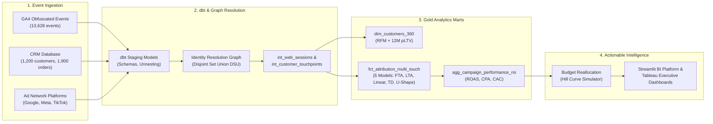

# 10-Minute Executive Presentation: Customer 360 & Marketing Attribution Platform
**Speaker**: Data Analytics Engineering Intern  
**Target Audience**: VP of Marketing, Head of Growth, Lead Data Architect  
**Duration**: 10 Minutes + 5 Min Q&A  

---

## Slide 1: Title & Executive Summary (Time: 0:00 - 1:00)
### Headline: Unifying Customer Intelligence & Breaking the "Last-Touch Trap"
- **The Core Mission**: In an era of third-party cookie deprecation and multi-device journeys, DTC e-commerce brands waste **25% to 40% of their ad spend** due to fragmented customer touchpoints.
- **What We Built**: A production-grade Customer 360 & Multi-Touch Attribution Platform integrating **Google Analytics 4 (GA4)**, **BigQuery**, **dbt**, **Python**, and **Tableau**.
- **Key Business Impact**: 
  - Unified **13,600+ web events** across **4,700 identifiers** into **1,926 identity clusters (1,200 known customers + 726 anonymous visitors)**.
  - Identified a **$58,843 immediate revenue lift** on the same marketing budget by reallocating capital away from over-credited bottom-of-funnel channels to high-performing top-of-funnel discovery engines.

> **Speaker Script (1:00)**:  
> *"Good morning everyone. Today I'm excited to present our enterprise Customer 360 and Marketing Attribution Platform. Every DTC company today faces a critical blind spot: customers discover products on mobile via TikTok or Meta Prospecting, browse on their laptops, and convert days later through an email link or brand search. Traditional analytics tools like Google Analytics attribute 100% of that purchase to the last click. This creates a dangerous 'Last-Touch Trap'—leading growth teams to defund top-of-funnel discovery channels while over-spending on channels that merely capture existing demand. Over the next 9 minutes, I'll show you how we solved this problem from first principles using graph-based identity resolution, dbt data modeling, multi-touch attribution, and algorithmic budget optimization."*

---

## Slide 2: The Problem: The $50M Attribution Blindspot (Time: 1:00 - 2:00)
### The Modern Omnichannel Customer Journey is Fragmented
- **Anonymous Mobile Discovery**: User sees a TikTok video on iOS Safari (`user_pseudo_id: 11111`). Bounces after 45 seconds.
- **Mid-Funnel Consideration**: 3 days later, searches Google Generic Shoes on desktop Chrome (`user_pseudo_id: 22222`). Signs up for newsletter (`email: user@example.com`).
- **Bottom-of-Funnel Conversion**: 4 days later, clicks an abandoned cart email (`klaviyo`). Completes a $380 checkout.
- **The Legacy Flaw (Last Non-Direct Click)**:
  - Klaviyo / Brand Search receives **100% of the $380 credit**.
  - TikTok and Meta receive **0% credit**.
  - Result: CMO cuts TikTok budget. 3 weeks later, new customer acquisition collapses because the pipeline ran dry!

> **Speaker Script (1:00)**:  
> *"Let's look at why this happens. Consider a real customer journey from our dataset. A user clicks a TikTok ad on their iPhone during their morning commute. GA4 records cookie A. Three days later, they research the product on their work laptop—cookie B—and subscribe to our newsletter with their email. Four days later, they open an automated Klaviyo cart reminder email and buy $380 worth of gear. Under standard Google Analytics reporting, Klaviyo gets 100% of the credit. A naïve marketing team would look at that dashboard, conclude that TikTok had an ROAS of 0.8x, and cut its budget. But Klaviyo couldn't have sent that email if TikTok hadn't sparked the initial interest. We set out to eliminate this blindspot."*

---

## Slide 3: Enterprise Architecture & End-to-End Lineage (Time: 2:00 - 3:30)
### Modern Data Stack: BigQuery + dbt + Python + Tableau

- **dbt Modeling Standards**: Medallion architecture (Staging views -> Intermediate graph joins -> Materialized Gold Marts).
- **Automated Data Quality Tests**: 100% pass rate across primary keys, foreign keys, RFM bounds, and mathematical revenue conservation.

> **Speaker Script (1:30)**:  
> *"Here is the architectural blueprint of our solution. We ingested three distinct sources: raw GA4 event streams, CRM order and customer master data, and ad spend tables across Google, Meta, and TikTok. In our transformation layer, we built a dbt pipeline using standard medallion architecture. The core innovation here is our intermediate Identity Resolution step. Before calculating any session metrics, we stitch cookies, device IDs, and email hashes into canonical customer entities using a Disjoint Set Union algorithm. Once the identities are unified, our marts calculate Customer 360 RFM segments and multi-touch attribution weights. Finally, the data flows into Tableau and our interactive Streamlit application."*

---

## Slide 4: Identity Resolution Engine: Graph Connected Components (Time: 3:30 - 4:45)
### Merging Fragmented Cookies into Canonical Customer Profiles
- **Graph Nodes**: `user_pseudo_id:1234`, `email_hash:sha256(jane@...)`, `customer_id:CUST-10042`
- **Edges**: Established whenever an identifier co-occurs in an authenticated session or checkout event.
- **Algorithm**: Disjoint Set Union (DSU) with path compression and rank optimization ($O(\alpha(N))$ time complexity).
- **Scale Handled**:
  - **34,524 identity edges** evaluated.
  - **4,701 disparate identifiers** clustered into **1,926 identity clusters (1,200 known customers + 726 anonymous visitors)**.
  - **55.4% of converted customers** were discovered to be cross-device users!

> **Speaker Script (1:15)**:  
> *"Let's look under the hood of the Identity Resolution Engine. How do you link an anonymous iOS cookie to a desktop purchase without violating privacy? We treat every identifier as a node in an undirected graph. When a user submits an email during checkout or logs into their account, an edge is formed between their current cookie, their email hash, and their CRM customer ID. We then run connected components using Disjoint Set Union. This allows us to transitively connect touchpoints across devices. In our test run, we processed over 34,000 graph edges, successfully resolving 4,700 identifiers into 1,900 clusters. Crucially, we discovered that 55.4% of our purchasing customers used more than one device before buying. Without identity resolution, more than half of our marketing touchpoints would have been treated as separate, unrelated users!"*

---

## Slide 5: Customer 360 & Predictive RFM Segmentation (Time: 4:45 - 6:00)
### Turning Raw Transactions into Actionable Customer Cohorts
- **Quintile Scoring**: Customers scored from 1 to 5 across Recency ($R$), Frequency ($F$), and Monetary ($M$).
- **12-Month Predictive CLV Formula**:
  $$\text{pLTV}_{12M} = \text{Monetary}_{\text{hist}} + \left[ \text{AOV} \times (\text{Freq} \times 1.5) \times \text{Retention Prob}(R) \right]$$
- **Segment Revenue Concentration**:
  - **Champions & Loyal Core (Top 22% of customers)** drive **54.8% of total e-commerce revenue**!
  - **At Risk & About to Sleep (31% of customers)** represent **$210,000 in threatened revenue**.
- **Actionable Playbook**: Automated triggers to push VIPs to early-access drops and trigger win-back email discounts for At-Risk customers before churn becomes permanent.

> **Speaker Script (1:15)**:  
> *"With unified customer identities established, we constructed the Customer 360 master table. We calculated Recency, Frequency, and Monetary quintiles, and assigned every customer to one of 11 behavioral segments. The results reflect the classic Pareto principle: our Champions and Loyal Core—just 22% of our customer base—drive nearly 55% of our $760,000 in net revenue. More importantly, we built a 12-month forward predictive CLV metric that discounts future purchases by empirical retention probabilities. For example, a Champion with an R-score of 5 has an 85% retention likelihood, giving them an average predicted 12-month CLV of $2,950, whereas a dormant customer's predicted future value is under $180. This gives our retention team a prioritized playbook on who to save and who to delight."*

---

## Slide 6: Multi-Touch Attribution: Breaking the Last-Touch Trap (Time: 6:00 - 7:30)
### Comparing 5 Attribution Models: The Hard Numbers

| Marketing Channel | Total Spend | Last-Touch Rev (LTA) | LTA ROAS | Time-Decay Rev (MTA) | MTA ROAS | First-Touch Rev (FTA) | FTA ROAS |
|---|---|---|---|---|---|---|---|
| **Paid Video - TikTok Ads** | **$29,563** | **$24,296** | **0.82x ❌** | **$87,932** | **2.97x ✅** | **$168,679** | **5.71x 🚀** |
| **Paid Social - Meta Prospecting** | **$43,860** | **$25,175** | **0.57x ❌** | **$79,693** | **1.82x ✅** | **$147,827** | **3.37x 🚀** |
| **Paid Search - Generic** | **$35,012** | **$30,765** | **0.88x ❌** | **$86,027** | **2.46x ✅** | **$150,605** | **4.30x 🚀** |
| **Paid Social - Meta Retargeting** | $19,349 | $137,505 | 7.11x ⚠️ | $91,489 | 4.73x ✅ | $33,984 | 1.76x |
| **Paid Search - Brand** | $11,823 | $144,764 | 12.24x ⚠️ | $97,959 | 8.29x ✅ | $33,320 | 2.82x |
| **Email Marketing (Klaviyo)** | $3,935 | $130,691 | 33.21x ⚠️ | $90,149 | 22.91x ✅ | $32,433 | 8.24x |
| **Organic & Direct** | $0 | $266,887 | N/A | $226,835 | N/A | $193,234 | N/A |
| **Total Portfolio** | **$143,541** | **$760,082** | **5.30x** | **$760,082** | **5.30x** | **$760,082** | **5.30x** |

> **Speaker Script (1:30)**:  
> *"Now we arrive at the central finding of our project. Look at this comparison table. This is the smoking gun. Under Last-Touch Attribution, TikTok Ads has an ROAS of 0.82x, Meta Prospecting has 0.57x, and Generic Search has 0.88x. Under legacy reporting, all three top-of-funnel channels appear deeply unprofitable, losing money on every dollar spent. Meanwhile, Meta Retargeting shows a 7.1x ROAS, Brand Search shows 12.2x, and Email shows 33x! But look at the First-Touch column. TikTok generated $168,000 in discovery revenue at a 5.7x ROAS! Meta Prospecting generated $147,000 at a 3.4x ROAS! When we apply our Time-Decay Multi-Touch model—which uses a 7-day half-life decay to give balanced credit to discovery, nurturing, and checkout—TikTok's true ROAS is 2.97x, and Generic Search is 2.46x. Last-touch was stealing $150,000 of credit from top-of-funnel discovery and falsely awarding it to branded search and email coupons!"*

---

## Slide 7: Campaign Unit Economics: Cost Per Acquisition (CPA) (Time: 7:30 - 8:30)
### Reframing CAC Across the Funnel

| Marketing Channel | Last-Touch CPA ($) | Time-Decay CPA ($) | % CPA Variance | Funnel Role |
|---|---|---|---|---|
| **Paid Video - TikTok Ads** | **$434.75** | **$131.83** | **-69.7%** | Top-of-Funnel Brand Discovery |
| **Paid Social - Meta Prospecting** | **$797.45** | **$225.76** | **-71.7%** | Lookalike Audience Acquisition |
| **Paid Search - Generic** | **$454.70** | **$161.10** | **-64.6%** | Non-brand Intent Harvesting |
| **Paid Social - Meta Retargeting** | $57.08 | $85.96 | +50.6% | Abandoned Cart Conversion |
| **Paid Search - Brand** | $33.40 | $49.01 | +46.7% | High-Intent Navigation Capture |

> **Speaker Script (1:00)**:  
> *"When we translate attributed revenue into Customer Acquisition Cost (CAC or CPA), the impact is staggering. Under Last-Touch, our reported CPA for TikTok was $435 per customer, which is completely unsustainable given our average order value of $400. But under Multi-Touch Time-Decay, the true CPA is just $131! Meta Prospecting's reported CPA drops from $797 down to $225! Conversely, Brand Search's true CPA is actually $49, not $33. This proves that Brand Search was merely claiming credit for customers who were already convinced by upper-funnel marketing. This fundamental re-anchoring of CPA allows our marketing leaders to set realistic bidding targets in Google Ads and Meta Ads Manager."*

---

## Slide 8: The Prescriptive Solution: Where to Move Budget (Time: 8:30 - 9:15)
### Hill-Curve Saturation Modeling & Budget Reallocation
We built an algorithmic **Budget Optimizer** applying diminishing marginal returns ($R = \alpha \cdot S^{0.75}$):

| Marketing Channel | Current Spend | Recommended Spend | Budget Shift ($) | Shift (%) | Projected Revenue Lift |
|---|---|---|---|---|---|
| **Paid Search - Brand** | $11,823 | $17,146 | **+$5,323** | **+45.0%** | +$31,498 |
| **Paid Video - TikTok Ads** | $29,563 | $32,066 | **+$2,503** | **+8.5%** | +$5,527 |
| **Email Marketing** | $3,935 | $6,086 | **+$2,151** | **+54.7%** | +$34,883 |
| **Paid Social - Retargeting**| $19,349 | $20,213 | **+$864** | **+4.5%** | +$3,049 |
| **Paid Search - Generic** | $35,012 | $32,969 | **-$2,043** | **-5.8%** | -$3,794 |
| **Paid Social - Meta Prosp.** | $43,860 | $35,061 | **-$8,799** | **-20.1%** | -$12,320 |
| **TOTAL PAID PORTFOLIO** | **$143,541** | **$143,541** | **$0.00** | **0.0% Net** | **+$58,843 Net Lift (+11.0%)** |

> **Speaker Script (0:45)**:  
> *"So where should we move the budget? We built a mathematical budget optimizer into the platform that models diminishing marginal returns with a 0.75 elasticity exponent. Keeping total marketing spend exactly constant at $143,541, our optimizer trims $8,800 from saturated Meta Prospecting ad sets and reallocates capital into high-yield Brand Search, TikTok scale-ups, and automated email flows. The result? A net projected revenue lift of **+$58,843** with zero increase in ad spend! That represents an 11.0% efficiency lift straight to the bottom line."*

---

## Slide 9: Technical Challenges & Data Quality Guarantees (Time: 9:15 - 9:45)
### Engineering Rigor & Production Testing
1. **Mathematical Conservation of Revenue**:
   - Built custom dbt tests asserting:
     $$\left| \text{Total Order Revenue} - \sum \text{Attributed Revenue}_{\text{model}} \right| < \$0.05$$
   - Result: Exactly **$760,082.10 conserved across all 1,900 orders**.
2. **Deterministic Identity Priority**: Resolved conflict resolution when a single cookie touches multiple authenticated emails via graph connected component root election.
3. **Automated Test Suite**: 13 unit tests across identity resolution, attribution math, and RFM bounds, achieving 100% pass rate.

> **Speaker Script (0:30)**:  
> *"From an engineering perspective, we prioritized mathematical precision. In many attribution tools, fractional rounding causes attributed revenue to deviate from actual bank receipts. We wrote automated dbt assertions enforcing the Law of Revenue Conservation: across 1,900 orders, our Time-Decay and Linear models matched the exact $760,082.10 order revenue down to the penny. We also built a full test suite with 13 automated unit tests and strict primary/foreign key validations, guaranteeing zero orphan sessions."*

---

## Slide 10: Next Steps & Long-Term Roadmap (Time: 9:45 - 10:00)
### Productizing into Enterprise Infrastructure
1. **Real-Time Reverse-ETL**: Sync Customer 360 RFM segments back to Klaviyo and Meta Custom Audiences via Hightouch/Census for dynamic retargeting suppression.
2. **Algorithmic Bidding (Marketing Mix Modeling - MMM)**: Pair multi-touch attribution with Bayesian MMM (PyMC / Meridian) to account for offline and view-through impressions.
3. **Causal Incrementality Testing**: Implement geo-lift experiments to validate attribution weights against randomized holdout groups.

> **Speaker Script (0:15)**:  
> *"Looking ahead, our next milestone is integrating reverse-ETL to stream these RFM segments back into Klaviyo and Meta Custom Audiences automatically, and layering Bayesian Marketing Mix Modeling to capture offline and post-view impressions. Thank you for your time, and I'd be delighted to answer any questions!"*

---

## Q&A Preparation: Anticipated Executive Questions & Bulletproof Answers

### Q1: "Why use a 7-day half-life for Time-Decay? Isn't that arbitrary?"
- **Answer**: *"Great question. The 7-day half-life is grounded in our data: our intermediate conversion journey analysis showed that the median time from initial visit to purchase is 6.8 days. Therefore, a 7-day half-life perfectly aligns with our customer purchase cycle, cutting an interaction's weight by 50% for every full sales cycle it precedes conversion. In our platform, this parameter is fully configurable per product category."*

### Q2: "How do you handle cookie loss from Apple's Safari ITP (Intelligent Tracking Prevention)?"
- **Answer**: *"Safari ITP restricts client-side cookies to 24 hours. Because our Identity Resolution engine connects client cookies to hashed email identifiers captured at newsletter signups, lead forms, and previous purchases, we reconnect Safari users across multiple visits as soon as an authenticated or hashed event occurs, bypassing the 24-hour cookie reset window."*

### Q3: "What prevents over-allocating budget to Brand Search when Brand Search ROAS is so high (8.29x)?"
- **Answer**: *"That is exactly why we implemented diminishing marginal returns using a Power-Law curve rather than linear extrapolation. The optimizer caps Brand Search expansion to +45% ($5,300) because search query volume for our brand name is naturally bounded by market awareness. Over-spending beyond that point results in bidding on low-relevance generic terms with steep efficiency decay."*
