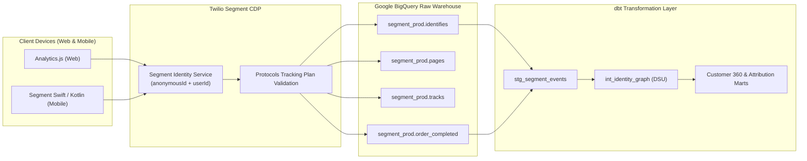

# Twilio Segment CDP Integration Specification
## Customer 360 & Marketing Attribution Platform

This document details the Twilio Segment Customer Data Platform (CDP) tracking architecture, event schemas, identity stitching payloads, and automated BigQuery destination sync configuration.

---

### 1. Architectural Overview: Segment to BigQuery Pipeline



---

### 2. Segment Event Payloads & Tracking Implementation

#### A. `analytics.identify()` – Customer Profile & Authentication
Triggered whenever a user signs in, creates an account, or enters an email in checkout.
```javascript
analytics.identify("CUST-10042", {
  email: "jane.doe@gmail.com",
  firstName: "Jane",
  lastName: "Doe",
  phone: "+1-555-482-1984",
  city: "New York",
  region: "New York",
  country: "United States",
  createdAt: "2026-08-14T14:22:10Z"
}, {
  integrations: {
    All: true
  }
});
```

#### B. `analytics.page()` – Campaign Attribution Context
Triggered on every page load with UTM parameters and referrer context.
```javascript
analytics.page("Product Detail Page", {
  title: "Active Noise Cancelling Headset",
  url: "https://shop.example.com/products/SKU-PRO-003?utm_source=tiktok&utm_medium=paid_social&utm_campaign=tiktok_ugc_viral_spring",
  path: "/products/SKU-PRO-003",
  referrer: "https://www.tiktok.com/",
  search: "?utm_source=tiktok&utm_medium=paid_social&utm_campaign=tiktok_ugc_viral_spring"
});
```

#### C. `analytics.track('Order Completed')` – E-Commerce Conversion
Triggered when an order confirmation is rendered.
```javascript
analytics.track("Order Completed", {
  order_id: "ORD-1045",
  checkout_id: "chk_987654321",
  affiliation: "Online Store",
  subtotal: 350.00,
  discount: 0.00,
  tax: 28.00,
  shipping: 0.00,
  total: 378.00,
  currency: "USD",
  products: [
    {
      product_id: "SKU-PRO-003",
      sku: "SKU-PRO-003",
      name: "Active Noise Cancelling Headset",
      price: 229.00,
      quantity: 1,
      category: "Audio"
    },
    {
      product_id: "SKU-PRO-006",
      sku: "SKU-PRO-006",
      name: "Smart Desk Mat with Qi Charger",
      price: 69.00,
      quantity: 1,
      category: "Accessories"
    }
  ],
  campaign: {
    source: "tiktok",
    medium: "paid_social",
    name: "tiktok_ugc_viral_spring"
  }
});
```

---

### 3. Segment Identity Graph Ingestion in dbt

When Segment syncs to BigQuery, it creates the `identifies` table linking `anonymous_id` to `user_id`. Our dbt model unifies Segment and GA4 identities:

```sql
-- models/staging/stg_segment_identifies.sql
WITH raw_identifies AS (
    SELECT
        id AS identify_event_id,
        anonymous_id,
        user_id,
        email,
        TO_HEX(SHA256(LOWER(TRIM(email)))) AS email_hash,
        timestamp AS received_at
    FROM {{ source('segment', 'identifies') }}
)

SELECT
    CONCAT('cookie:', anonymous_id) AS node_a,
    CONCAT('crm:', user_id) AS node_b,
    'SEGMENT_IDENTIFY' AS edge_source,
    1.00 AS confidence_weight
FROM raw_identifies
WHERE anonymous_id IS NOT NULL AND user_id IS NOT NULL;
```

---

### 4. Reverse-ETL: Syncing Customer 360 RFM Audiences Back to Segment

Our Customer 360 table `dim_customers_360` can be synced back to Segment using Census or Hightouch to power automated marketing:
- **Segment Audience: `VIP_Champions`** -> Sync to Meta Custom Audiences for lookalike targeting.
- **Segment Audience: `At_Risk_High_Value`** -> Trigger automated Klaviyo 20% discount flows.
- **Segment Audience: `Lost_Dormant`** -> Suppress from paid retargeting to eliminate wasted ad spend.
